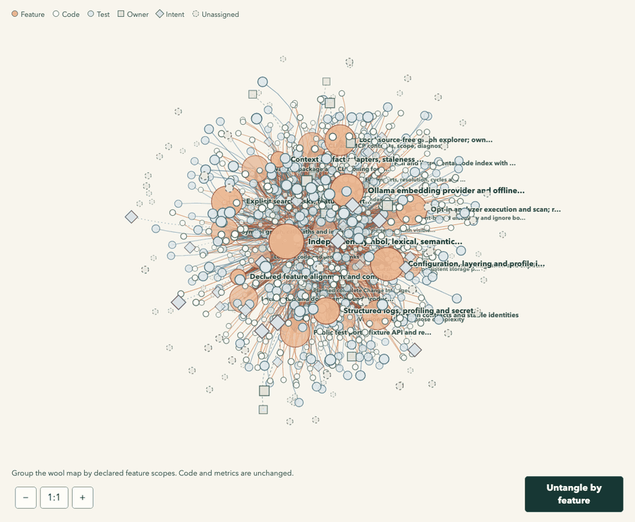
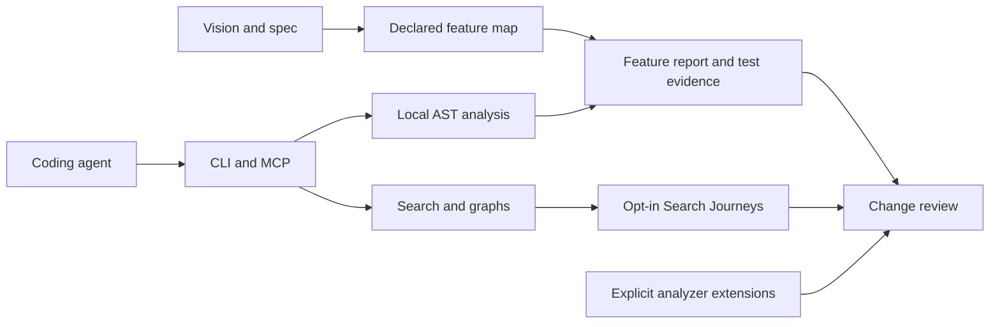

<p align="center">
  <picture>
    <source media="(prefers-color-scheme: dark)" srcset="./docs/assets/untangle-mark-dark.svg" />
    
  </picture>
</p>

<h1 align="center">Untangle</h1>

<p align="center"><strong>Keep spec-driven code easy to change.</strong></p>
<p align="center">A local search and complexity harness for coding agents.</p>

<p align="center">
  <a href="https://github.com/lboel/untangle/actions/workflows/ci.yml"></a>
  <a href="https://www.npmjs.com/package/@untangle-code/cli?activeTab=versions"></a>
  <a href="./LICENSE"></a>
  <a href="./package.json"></a>
  <a href="./package.json"></a>
  <a href="#connect-your-agent"></a>
</p>

<p align="center">
  <a href="https://lboel.github.io/untangle/">Website</a> ·
  <a href="#first-result-without-search-services">Quickstart</a> ·
  <a href="#three-layers-one-development-workflow">Three layers</a> ·
  <a href="#guided-setup-and-a-spatial-feature-map">3D map</a> ·
  <a href="#connect-spec-driven-development">SDD connectors</a> ·
  <a href="#connect-your-agent">MCP</a> ·
  <a href="#architecture-and-documentation">Docs</a> ·
  <a href="./CONTRIBUTING.md">Contributing</a>
</p>

<p align="center">
  <a href="https://lboel.github.io/untangle/untangle-example.html#untangle-view">
    <picture>
      <source media="(prefers-reduced-motion: reduce)" srcset="./docs/assets/untangle-feature-map-still.png" />
      
    </picture>
  </a>
  <br />
  <sub>Feature grouping on a frozen snapshot of Untangle's own repository (<code>d11bdaf</code>). <a href="https://lboel.github.io/untangle/untangle-example.html#untangle-view">Open the interactive 3D map</a> to regroup by code, tests, ownership, Vision / Spec or unassigned files.</sub>
</p>

**Specs describe what should exist. Untangle helps an agent find the implementation,
understand its responsibility and keep its complexity visible.**

Combine local search, AST metrics and graphs with declared feature ownership. Inspect the
whole feature before an edit, use real test evidence in review, and observe recurring search
friction as the codebase grows. Start with existing specs or analyze code first and add
product context gradually.

> **npm preview.** Install Untangle from the `next` channel. See the
> [release guide](./docs/RELEASE.md) for the package and platform checks.

## First result without search services

Use **Node.js `^22.13.0 || >=24.0.0`**. In a project that uses npm, install Untangle
as an exact dev dependency so the team can use the same version:

```bash
cd /path/to/your/project
npm install --save-dev --save-exact @untangle-code/cli@next
npm exec -- untangle complexity --top=10
```

The install resolves `next` once and saves the exact version. Commit `package.json` and
`package-lock.json` to share that version with your team.
Direct analysis needs no project configuration, index, embedding service or cloud account.

**Set up local search.** Install and start [Ollama](https://docs.ollama.com/quickstart) locally.
From your project root, pull an embedding model, open the wizard and select **LanceDB**.
The index lives under `.untangle/index/lancedb`.

```bash
ollama pull nomic-embed-text
npm exec -- untangle init --interactive --embedding-model=nomic-embed-text:latest
```

When the wizard offers **Apply setup and build the LanceDB index**, review the model and
local endpoint, then select it to start indexing. With npm `0.1.1`, apply the configuration
in the wizard, then run the index command separately:

```bash
npm exec -- untangle index
npm exec -- untangle query "account lookup" --mode=hybrid --require-fresh
```

To preview and write configuration without probing services, use offline setup:

```bash
npm exec -- untangle init --offline --dry-run
npm exec -- untangle init --offline
```

**Try it once in any repository.** Run this from the project root, even if it has no
`package.json`. npm uses its cache and leaves the project's dependencies alone.

```bash
npm exec --yes --package=@untangle-code/cli@next -- untangle complexity --top=10
```

**Use it across projects.** Install the preview globally, then run `untangle` from any project root.

```bash
npm install --global @untangle-code/cli@next
untangle --version
```

The remaining CLI examples use `untangle` directly. For a project-local installation, use
`npm exec -- untangle` in its place.

<details>
<summary>Build from source for development</summary>

Use **pnpm 10.34.5**:

```bash
git clone https://github.com/lboel/untangle.git
cd untangle
pnpm setup:local
```

This installs locked dependencies, builds Untangle and analyzes its own sources. To analyze
another project from the checkout, run `pnpm setup:local --project=/absolute/path/to/project`.
See [Contributing](./CONTRIBUTING.md) for the development workflow.

</details>

## Three layers, one development workflow

| Layer | What Untangle provides | What the agent learns |
|---|---|---|
| **Search and understand code** | Independent symbol, lexical and semantic retrieval; hybrid fusion; AST complexity; file/symbol graphs and resolvable HTTP boundaries. | Where the implementation, tests, callers and dependencies live. |
| **Measure complexity per feature** | A declared **Vision → Spec → Feature → Code/Tests → Ownership** chain; complete scopes, shared files, budgets and actionable `agentHints`. | Which responsibility is growing complex across files, helpers and teams. |
| **Observe search effort** | Opt-in Search Journeys: attempts, reformulations, rank, candidate load, confirmed targets and abandoned tasks, separated by declared task context. | Where navigation repeatedly becomes difficult and deserves investigation. |

A search hit leads to its declared responsibility. The feature report keeps the full scope,
metrics and test evidence visible. Search observations add evidence about how easily agents
can find that scope.

**Finding the right responsibility directly is a useful structural signal.** A hit alone
does not prove correct behavior or sound architecture. Untangle does not infer complete
features or turn these signals into a universal quality or productivity score.

## Guided setup and a spatial feature map

```bash
untangle init --interactive --root=/path/to/project
untangle graph features --root=/path/to/project --format=json
```

On an interactive terminal, `init` offers guided setup automatically. Select vision, specs
and feature declarations, connect supported SDD artifacts, add search services or analyzers,
and create a local feature/code map. **Only the final confirmation writes files.** Preparing
an integration recipe and installing or starting a tool are separate choices.

Explore declared features, code, tests, intent and ownership as an **interactive 3D network**:
rotate, pan, zoom, filter and focus on a node's neighbors. Complete feature metrics remain
available independently of rendering caps. English controls, source-bound HTML and JSON
stay in **`<project>/.untangle/feature-map/`**, without CDN or cloud dependencies. Original
project names stay intact. Unmapped sources, rendering limits and evidence gaps remain visible;
spatial proximity does not establish a relationship.

Choose **Untangle by** to animate the map into **Features**, **Code areas**, **Test areas**,
**Ownership**, **Vision / Spec** or **Unassigned** groups. Code and test areas use actual
directories; ownership and document context follow declared feature links. Shared context
stays separate. Pause, resume or return to the tangle without changing code or measurements.
Open **Groups** for complete group names and visible/total snapshot-node counts at readable
text size, independently of the diagram's zoom.

Setup defaults to an embedded LanceDB index and offers Qdrant/Ollama, a pinned local SonarQube server or existing Sonar project metrics,
a hash-verified Sentrux binary with an MCP template, and custom analyzer formats. Installing
a server or preparing an MCP entry does not establish a successful scan.
[Setup and integration details →](./docs/INIT_INTEGRATIONS.md)

<details>
<summary>Scriptable setup, offline use and credentials</summary>

```bash
untangle init --no-interactive --offline --format=json
untangle init --offline --dry-run --format=json
```

JSON, pipes and dry-run do not open the TUI. Explicit `--interactive --offline` may prepare
local files but performs no downloads or tool execution. Tokens are referenced by environment
variable name, never written into project files. Licenses, project trust and credentials
retain their own checks.

</details>

## Connect your agent

From the project with the local npm installation, get the absolute paths to Node and the
installed CLI:

```bash
node -p 'process.execPath'
node -p "require.resolve('@untangle-code/cli')"
```

For a host supporting `mcpServers`, insert those paths and your project root:

```json
{
  "mcpServers": {
    "untangle": {
      "command": "/absolute/path/to/node",
      "args": [
        "/absolute/path/to/project/node_modules/@untangle-code/cli/dist/index.js",
        "mcp",
        "--stdio",
        "--root=/absolute/path/to/project"
      ]
    }
  }
}
```

The fixed root binds the engine to your project independently of the host's working
directory. Add the entry to your host's MCP configuration.

| Task | MCP tools |
|---|---|
| Start without an index | `untangle_complexity`, `untangle_hotspots`, `untangle_product` |
| Search a compatible index | `untangle_search` with `mode`, `requireFresh`, `includeContext`, `includeLinked` |
| Follow relationships | `untangle_graph_query`, `untangle_symbols`, `untangle_symbol`, `untangle_flow`, `untangle_impact` |
| Connect frontend and backend | `untangle_boundaries` |
| Observe search effort | `untangle_search_session` |
| Diagnose and inspect graphs | `untangle_health`, `untangle_about`, `untangle_graph_status`, `untangle_graph_stats`, `untangle_graph_cycles`, `untangle_graph_visualize` |

Registered tools and executable capabilities are separate; unimplemented operations return
`FEATURE_UNAVAILABLE`. The default runtime starts neither an index nor a test process.
Errors and partial results remain structured. [Copyable agent workflow →](./docs/AGENT_WORKFLOW.md)

## Connect spec-driven development

| Connector | Local artifacts | Result |
|---|---|---|
| **Spec Kit** | `.specify/` and supported feature specs, plans, tasks and referenced files | Source-bound requirements, task states and explicit code/test references. |
| **OpenSpec** | Capability specs and supported active change proposals, designs, tasks and delta specs | Proposed feature identities with requirement changes and provenance. |

```bash
# Preview supported artifacts without writing.
untangle product connect auto --dry-run --format=json

# Explicitly save a connector report and proposed feature manifest.
untangle product connect spec-kit --format=json
untangle product connect openspec --format=json
```

Connectors read local artifacts without executing framework scripts. Their output is a
**review draft** in `.untangle/sdd/`: planned features, proposed boundaries and no invented
owners. Task checkboxes do not establish implementation or passing tests. Complete the
returned draft's code/test scopes and ownership, then explicitly pass its actual path to
`product --manifest=…` and `graph features --feature-map=…`. Existing declarations are preserved.
[Supported layouts, limits and evidence →](./docs/SDD_CONNECTORS.md)

## From a spec to a bounded change

Example paths and feature IDs refer to declarations in your project:

```bash
untangle product --path=src/accounts/lookup.ts --format=json

untangle product --feature=accounts.lookup --max-cognitive=15 --require-complete \
  --format=json --run-tests -- pnpm exec vitest run src/accounts/lookup.test.ts
```

`untangle.features.json` declares intent, complete code/test scopes, criteria and owners.
Without it, `product` reports `needs_manifest`. Review checks can surface large units, shared
implementation, ownership spread, cycles, missing evidence and exceeded budgets.

<details>
<summary>Drafts, scope boundaries and test-evidence contracts</summary>

```bash
untangle product --draft --feature=accounts.lookup --path=src/accounts/lookup.ts --format=json
```

This writes no manifest. Review and save only `report.draft`, adding private helpers, other
files, intent, tests and ownership. `--path` selects features, not a smaller measurement
scope. Shared files stay fully visible per feature and count once in the combined code union.
Code and tests are measured separately.

A test path is not an executed test. Execution reports are content-bound, and a later command
without `--test-evidence` does not automatically reuse an earlier run. `evidence_consistent`
means consistent declared evidence, not independently proven semantic conformance or durable
ownership. Under `--require-complete`, unreviewed declarations, missing evidence or exceeded
budgets can exit 5 while preserving the report.

[Feature alignment →](./docs/FEATURE_ALIGNMENT.md)

</details>

## Local search with inspectable freshness

New projects use **LanceDB**, stored in `.untangle/index/lancedb`. No database server or
Docker is needed. Qdrant remains available for an owned local service or an existing server.
Semantic search separately needs a configured embedding service, such as Ollama.

Start with symbol and lexical search, without an embedding service:

```bash
untangle init --no-interactive
untangle doctor
untangle index --embedder=offline

untangle query "lookupAccount" --mode=symbol --require-fresh --context --linked
untangle query "lookup_account" --mode=lexical --require-fresh --context --linked
```

Symbol, lexical and semantic paths are independent; hybrid fuses them. Indexing and queries
share versioned identifier tokenization: whole names and components of `getUserById`,
`user_id` and `HTTPServer` stay searchable. Scores, provenance, coverage and omissions remain visible.

| Capability | Storage | Embedding service |
|---|---|---|
| Direct complexity, feature and HTTP-boundary analysis | Not required | Not required |
| Index with `--embedder=offline` | LanceDB or Qdrant | Not required; deterministic vectors without language-model semantics |
| Symbol/lexical query against a compatible index | LanceDB or Qdrant | Not required for the query |
| Semantic/hybrid query with a service profile | LanceDB or Qdrant | Required |

To use semantic search, configure and start your embedding provider, run `untangle index`
with its service profile, then query with `--mode=semantic` or `--mode=hybrid`. Offline and
service profiles remain separate indices.

Choose storage during `untangle init --interactive`, pass `init --storage=lancedb` or
`init --storage=qdrant`, or set it explicitly in the project configuration:

```toml
[storage]
backend = "lancedb"
path = ".untangle/index/lancedb" # Relative to the repository root
```

For Qdrant, set `storage.backend = "qdrant"` and retain the project's `[qdrant]` settings.
Existing configurations with a Qdrant section keep using Qdrant. For older zero-configuration
Qdrant indices, explicitly select Qdrant to access that backend again. Environment overrides are
`UNTANGLE_STORAGE_BACKEND` and `UNTANGLE_LANCEDB_PATH`. For example, choose LanceDB for
one invocation without rewriting an existing Qdrant configuration:

```bash
UNTANGLE_STORAGE_BACKEND=lancedb untangle index --embedder=offline
UNTANGLE_STORAGE_BACKEND=lancedb untangle query "lookupAccount" --mode=symbol --require-fresh
```

**Switching selects a separate index; it does not copy or delete data.** Run `untangle index`
for the selected backend and embedding profile. Switching back can reuse its prior index
once freshness checks pass. Each index state is bound to its backend and canonical location.

The first LanceDB adapter uses bounded, exact scans for vector and identifier-token ranking.
It stores real Lance tables; it does not promise Qdrant-equivalent scores, approximate-nearest-
neighbor indexing, or performance on large repositories. [Storage details →](./packages/storage-lancedb/README.md)

<details>
<summary>Refresh, watch and partial-search contracts</summary>

```bash
untangle query "lookupAccount" --refresh --require-fresh --context --linked
untangle watch --index --reconcile=5000
```

`indexFreshness` distinguishes `fresh`, `stale`, `unknown` and `incompatible`. Content checks
detect additions, deletions and edits with unchanged timestamps. `--require-fresh` rejects
unchecked or stale evidence; otherwise explicitly marked older hits may remain useful.
Freshness is a point-in-time assessment.

A failed retrieval branch preserves usable partial results with `SEARCH_BRANCH_UNAVAILABLE`
and CLI exit 4. MCP exposes verified partial data in `error.details.data`.
`--abstention=evidence` can show candidates with a verdict without making incomplete evidence
complete. Services start through explicit setup confirmation or your own service management.

[Agent workflow →](./docs/AGENT_WORKFLOW.md)

</details>

## Search effort as another complexity signal

An agent explicitly starts a Search Journey through MCP. Queries attach to its session and
step; a confirmed target completes the task, while unsuccessful work is recorded as `abandon`.
The declared `featureId` connects observed search routes with static target complexity.

Declared model, harness, strategy, task class/mix and prior knowledge form separate contexts.
These observations support investigation of names, docs and feature boundaries; they do not
establish a causal diagnosis, normalized time series or productivity improvement.

Targets and queries use workspace-local HMAC fingerprints by default. Plain text needs
`retainText: true`; file/symbol locators and measurements remain. This is pseudonymization,
not encryption. [Search Journey context →](./docs/SEARCH-JOURNEY-CONTEXT.md)

## Add SonarQube, Sentrux and other analyzers

Use Untangle's extension runtime to bring existing analyzer evidence into the same review.
Definitions, programs, servers, licenses and credentials are selected explicitly.

| Integration | What it contributes |
|---|---|
| **SonarQube** | Setup recipes and HTTP access to a configured project's metrics; reading metrics starts no new Sonar scan and proves no matching source revision. |
| **Sentrux** | A hash-verified binary setup and MCP template; installation alone is not a successful scan. |
| **Other analyzers** | Extension manifests with `sarif`, `junit-xml`, `generic-findings` or `generic-metrics`. |

```bash
untangle extensions add --from /outside/the/project/analyzer/manifest.toml
untangle extensions enable analyzer-id
untangle extensions status analyzer-id
untangle scan --feature=accounts.lookup --format=json
```

`add` and `enable` start nothing. Explicit scans may invoke enabled binary/HTTP analyzers;
container provisioning additionally requires `--yes`. Remote manifests require SHA-256;
project-local definitions require `--allow-project-local` and are not trusted automatically.
License acknowledgment remains separate.

Reports distinguish `ownMetrics`, `externalSignals` and `notMeasured`. Repository-wide
external numbers remain context rather than feature complexity or additions to Untangle's
metrics. Full Sonar/Sentrux replacement or parity is not claimed.
[Analyzer workflow →](./docs/ANALYZER-FEATURE-WORKFLOW.md) · [Extension contract →](./extensions.md)

## Inspect frontend and backend together

```bash
untangle graph boundaries --path=apps/web/src/Orders.vue --format=json
untangle product --path=apps/web/src/Orders.vue --format=json
```

Vue SFC inline scripts yield AST symbols, calls, imports and complexity at original positions.
JS, TS, JSX and TSX use their respective adapters. With explicit `.untangle/services.json`
boundaries, a separate report connects statically resolvable `fetch` requests and bounded
local wrappers to mounted FastAPI routes. Dynamic values and ambiguous routes remain visible.

Template-event execution is not established. Templates, styles and custom blocks are outside
script complexity; file-wide SLOC includes the physical SFC.
[Frontend/backend scope →](./docs/FEATURE_ALIGNMENT.md)

## Commands and limits

| Command | Responsibility |
|---|---|
| `init` | Detect the project and prepare configuration, with optional guided setup. |
| `complexity` | Direct source metrics, coverage, hotspots and `--max-*` thresholds. |
| `product` / `product connect` | Declared feature evidence and supported SDD review drafts. |
| `index` / `query` | Lossless chunking, indexing and independent retrieval paths. |
| `graph` / `flow` | File/symbol relationships, cycles, context and impact. |
| `graph features` | Offline interactive 3D feature/code map and source-bound JSON. |
| `graph boundaries` | Current HTTP boundaries without an index or running backend. |
| `scan` / `extensions` | Own measurements alongside explicitly enabled external evidence. |
| `watch` | Complexity deltas and optional serialized index updates. |
| `doctor` | Configuration, parsers, services and index health. |
| `mcp --stdio` | Local engine with validated MCP responses. |

Commands expose `--help` and structured JSON. Exit 0 can mean **report produced**: `scan`
may contain analyzer failures, and `product` may contain budget violations or missing evidence.
Inspect status, coverage and warnings in automation.

Parsers cover the JS/TS family including Vue scripts, Python, Go, Rust and other ast-grep
adapters. Markdown and structured text use separate prose/text treatment; coverage and parse
gaps remain explicit. Svelte/Astro SFCs and additional backend routers are not implemented.
`changes`, `gate`, automatic feature discovery and the general `reduce-complexity` loop remain
planned. Untangle is not an editor, compiler, runtime monitor or independent coding agent.

## Develop and verify a release

See [CONTRIBUTING.md](./CONTRIBUTING.md) for development and the
[release guide](./docs/RELEASE.md) for original tarballs, SBOM, matrix evidence and publication.

<details>
<summary>Required verification commands</summary>

```bash
pnpm install --frozen-lockfile
pnpm build
pnpm typecheck
pnpm lint
pnpm test:unit
pnpm --workspace-concurrency=1 -r --if-present run test
pnpm check-licenses
pnpm check-publishable
pnpm e2e:smoke
pnpm e2e:release
pnpm e2e:search
```

Unit tests need no search services. LanceDB persistence is checked locally; live semantic
search acceptance uses an embedding service, and Qdrant has separate integration coverage. `e2e:release`
installs unchanged original tarballs through isolated npm and pnpm consumers. The configured
release matrix covers Linux/macOS × Node 22/24; only actual runs at the candidate commit
establish platform evidence. Local checks do not prove an unrun matrix or public installation.

</details>

Untangle analyzes itself using a [bounded self-improvement procedure](./CONTRIBUTING.md):
freeze the current workspace, inspect complete metrics and graph/search context, simplify one
responsibility, then verify behavior, contracts and real search cases. A smaller hotspot is
insufficient if complexity moves into new helpers. Cognitive `execution_unit`, `self` and
`top_level` stay separate; inclusive parent/child measurements are not added twice.

## Architecture and documentation



| Read next | Document |
|---|---|
| Agent setup and worked example | [Agent workflow](./docs/AGENT_WORKFLOW.md) |
| SDD framework contracts | [SDD connectors](./docs/SDD_CONNECTORS.md) |
| Features, ownership, tests and frontend/backend | [Feature alignment](./docs/FEATURE_ALIGNMENT.md) |
| Search contexts, abandonment and privacy | [Search Journey context](./docs/SEARCH-JOURNEY-CONTEXT.md) |
| Own metrics and analyzer evidence | [Analyzer workflow](./docs/ANALYZER-FEATURE-WORKFLOW.md), [Scan](./docs/SCAN.md) |
| External analyzer definitions | [Extension contract](./extensions.md), [complexity signals](./docs/COMPLEXITY-SIGNALS.md) |
| Local search infrastructure | [Docker guide](./docker/README.md) |
| Candidates and publication | [Release guide](./docs/RELEASE.md), [Changelog](./CHANGELOG.md) |
| Contributing | [CONTRIBUTING.md](./CONTRIBUTING.md) |
| Logo, visuals and asset provenance | [Brand guide](./docs/BRAND.md), [licensing details](./docs/LICENSING.md) |
| Product sources and architecture | [vision.md](./vision.md), [product.md](./product.md), [architecture.md](./architecture.md), [portfolio.md](./portfolio.md) |
| Normative contract and work plan | [spec.md](./spec.md), [docs/BUILD_PLAN.md](./docs/BUILD_PLAN.md) |
| Historical acceptance/parity records | [Acceptance](./docs/ACCEPTANCE.md), [Parity](./docs/PARITY.md) |

The hexagonal core in `packages/` contains domain, use cases, parsers, scanner, chunking,
metrics, search, graphs, storage and the extension runtime. `apps/cli` hosts CLI/MCP;
`apps/mcp-server` is a private compatibility wrapper and `apps/website` the private landing page.
Thin host plugins, a VS Code extension, Change Engine and policy/portfolio gates remain planned.

<details>
<summary>Measurement and format decisions</summary>

- Code and prose use distinct metric families. Markdown produces `prose_section` units;
  JSON/YAML/TOML/XML use format-aware text chunks rather than invented code complexity.
  Lockfiles are `generated_content`.
- `no_metric_defined` and `generated_content` identify missing metrics and generated content.
  Understood text is not silently labeled `unsupported_language`.
- Prose reports section depth, longest section, reference density, dead relative-link ratio
  and repetition. `structureLoad` sums heading levels. Without a resolver,
  `unresolvedLinkRatio` stays `null`. `ProseNumberV1` is separate from code and external numbers.
- Minification rules preserve code/prose structure despite isolated long lines; structured
  data also uses the single-line rule. Changed chunker/parser versions require a current
  index. Unknown legacy generations are not attached to a new graph.
- CLI totals use `execution_unit`; hotspots are individual symbols. The cyclomatic base per
  selected execution unit, additional helpers and indirection remain part of the tradeoff.

</details>

## License

**[GNU Affero General Public License v3.0 only — AGPL-3.0-only](./LICENSE).** The repository's
first-party code, documentation, logos and visual assets share this license. The decision
and scope are recorded in [NOTICE](./NOTICE) and [licensing details](./docs/LICENSING.md).
Third-party dependencies retain their own licenses and notices.

Copyright (C) 2026 Luke Bölling and contributors. Contributors retain their rights.
**Pull requests are welcome** under AGPL-3.0-only, with no separate CLA or DCO gate.
See [CONTRIBUTING.md](./CONTRIBUTING.md) for the workflow and checks.

Trademark rights and publishing permissions for `@untangle-code` are separate from the
copyright license and from release verification.
