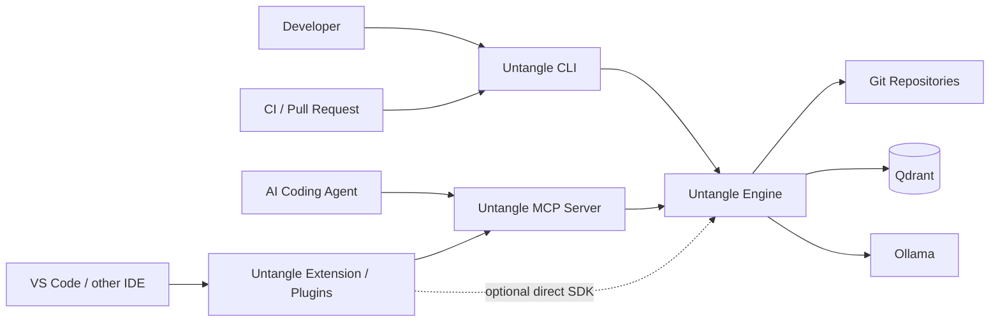
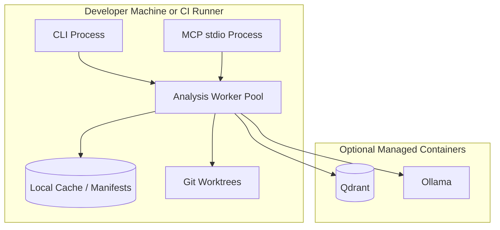
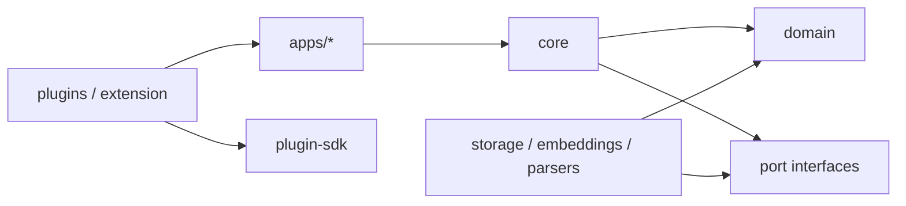
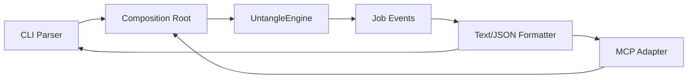
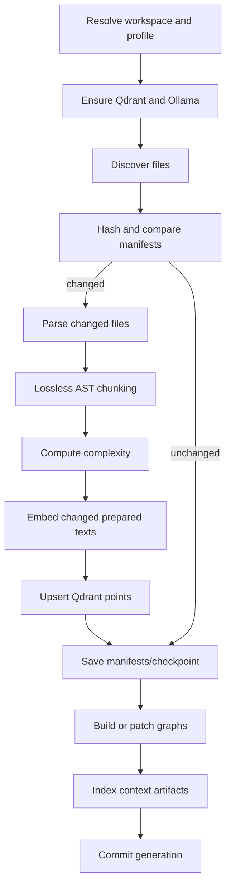
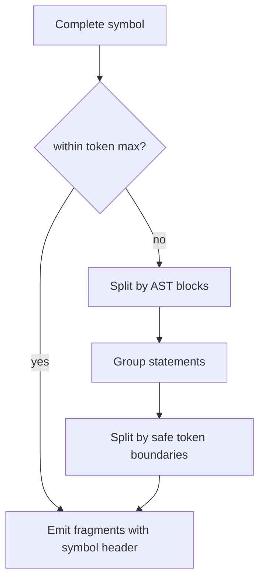
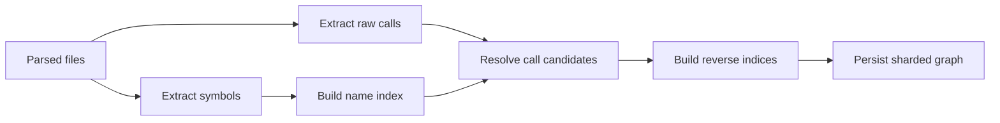
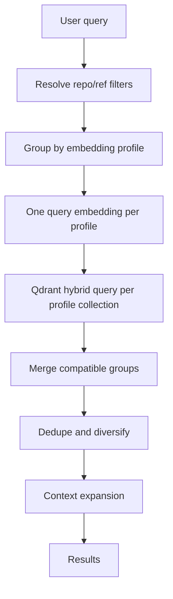
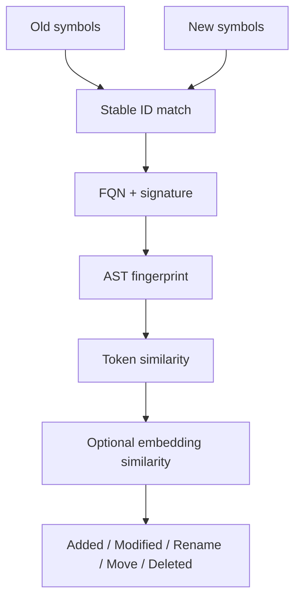

# Untangle — Architecture

**Status:** Draft 0.1  
**Architecture version:** `architecture-v1`  
**Product:** Untangle  
**Purpose:** Technical target architecture, components, data flows, package boundaries and operating models.  
**Related documents:** [`vision.md`](./vision.md) · [`product.md`](./product.md) · [`spec.md`](./spec.md)

---

<a id="1-architekturziele"></a>

## 1. Architecture goals

Untangle is designed as a **local-first, polyglot, incremental codebase intelligence engine**. Its architecture must support four distribution forms at once:

1. An npm CLI with the `untangle` binary;
2. An MCP server for coding agents;
3. A programmatic npm API;
4. Thin plugins and IDE extensions.

The analysis engine must not be duplicated for each surface.

<a id="11-wichtigste-qualitätsattribute"></a>

### 1.1 Key quality attributes

| Attribute | Architecture goal |
|---|---|
| Correctness | Deterministic IDs, versioned profiles, visible uncertainty |
| Privacy | Local default operation, no unsolicited source transmission |
| Incrementality | No reparsing/re-embedding of unchanged files |
| Recovery | Checkpoints and generations across process crashes |
| Scalability | Multiple repositories, lazy graph loading, byte-bounded upserts |
| Extensibility | Parser, storage, embedding and host adapters |
| Distribution | One engine artifact for CLI, MCP and plugins |
| Explainability | Return score, graph, metric and risk components |
| Portability | Linux, macOS, Windows; managed or external infrastructure |

---

<a id="2-architekturgrundsätze"></a>

## 2. Architecture principles

<a id="21-hexagonaler-kern"></a>

### 2.1 Hexagonal core

Domain and application services know no CLI, MCP, VS Code or Docker details. They use ports:

```text
VectorStore
MetadataStore
GraphStore
SearchJourneyStore
EmbeddingProvider
ParserRegistry
FileSystem
GitProvider
LockProvider
Clock
Logger
```

Adapters implement these ports for Qdrant, Ollama, Git CLI, Node filesystem, MCP and IDEs.

<a id="22-event-getriebene-jobs"></a>

### 2.2 Event-driven jobs

Long operations return typed job events:

```text
JobQueued
InfrastructureReady
FilesDiscovered
FileAnalyzed
EmbeddingBatchCompleted
PointsStored
CheckpointSaved
GraphUpdated
JobCompleted
JobFailed
JobCancelled
```

CLI, MCP and extensions consume the same event stream differently.

<a id="23-versionierte-datenproduktion"></a>

### 2.3 Versioned data production

Every generated record carries:

```text
schema_version
analyzer_version
parser_version
chunker_version
metrics_version
embedding_profile_id
generation_id
```

A new algorithm does not silently overwrite the meaning of existing values.

### 2.4 Clean-room Boundary

Untangle owns its interfaces, data models, tool names, tests and implementations. External source
code is used only when its license and a project decision explicitly permit it.

---

<a id="3-systemkontext"></a>

## 3. System context



### 3.1 Trust Boundaries

- Workspace files and Git repositories are user input.
- Qdrant and Ollama may be local or remote.
- Plugins run in other host processes and must therefore remain thin.
- MCP calls are untrusted input and are fully validated.
- Source paths must not escape configured workspace roots.

---

<a id="4-container--und-prozesssicht"></a>

## 4. Container and process view



<a id="41-prozessmodell-für-version-1"></a>

### 4.1 Process model for version 1

Version 1 defaults to one Node process per CLI or MCP instance. CPU- or parser-intensive work may
be distributed over worker threads. Cross-process coordination uses project-scoped locks and
persistent job metadata.

A separate local daemon is initially optional. The architecture must allow it later without
changing domain contracts.

<a id="42-langfristiger-daemon-modus"></a>

### 4.2 Long-term daemon mode

```text
untangle daemon start
untangle daemon status
```

CLI, MCP and extensions could then access the same process through a local socket or HTTP. Benefits:

- One watcher per workspace;
- Shared cache;
- Fewer Ollama connection pools;
- A central job scheduler;
- Faster plugin startup.

This mode is not mandatory for the MVP, but ports and event contracts must not prevent it.

---

<a id="5-monorepo-struktur"></a>

## 5. Monorepo structure

A pnpm or npm workspace monorepo is recommended.

```text
untangle/
├─ apps/
│  ├─ cli/
│  ├─ mcp-server/
│  ├─ website/
│  ├─ vscode-extension/
│  └─ github-action/
├─ packages/
│  ├─ core/
│  ├─ domain/
│  ├─ config/
│  ├─ scanner/
│  ├─ watcher/
│  ├─ parser-registry/
│  ├─ chunker/
│  ├─ complexity/
│  ├─ change-engine/
│  ├─ search/
│  ├─ file-graph/
│  ├─ symbol-graph/
│  ├─ context-artifacts/
│  ├─ embeddings-ollama/
│  ├─ storage-qdrant/
│  ├─ storage-local/
│  ├─ jobs/
│  ├─ observability/
│  ├─ plugin-sdk/
│  └─ testkit/
├─ plugins/
│  ├─ claude-code/
│  ├─ cursor/
│  ├─ codex/
│  └─ gemini/
├─ schemas/
├─ fixtures/
├─ benchmarks/
├─ docker/
├─ scripts/
└─ docs/
```

<a id="51-öffentliche-vs-interne-pakete"></a>

### 5.1 Public versus internal packages

Public:

```text
@untangle-code/cli
@untangle-code/core
@untangle-code/config
@untangle-code/plugin-sdk
@untangle-code/testkit
```

Internal implementation packages start with `private: true`. They are published only after their
APIs have been stabilized independently.

### 5.2 Dependency Rules



Prohibited:

- `domain` imports adapters;
- Parser adapters import MCP or CLI;
- The VS Code extension imports internal indexer implementations;
- Storage Qdrant knows UI types;
- The complexity engine calls embeddings.

---

<a id="6-kernmodule"></a>

## 6. Core modules

## 6.1 Domain

Contains pure types, IDs, results and invariants:

```text
Workspace
Repository
RefSnapshot
FileSnapshot
Symbol
CodeChunk
EmbeddingProfile
ComplexitySnapshot
FileGraph
SymbolGraph
ChangeEvent
SearchJourney
DynamicSearchComplexity
QualityGateResult
Job
```

Domain code has no network or filesystem access.

## 6.2 Core Application

Orchestrates use cases:

```text
IndexWorkspace
UpdateWorkspace
SearchCode
BuildGraphs
GetSymbolContext
AnalyzeImpact
ComputeComplexity
AnalyzeChanges
EvaluateQualityGate
IndexContextArtifacts
```

Core defines transaction boundaries, jobs, checkpoints and error semantics.

## 6.3 Config

Responsible for:

- Configuration discovery;
- Layering and overrides;
- JSON Schema validation;
- Path resolution;
- Secret references;
- Canonical effective configuration;
- Embedding and index profile hashing;
- Migration of older configuration versions.

## 6.4 Scanner

Responsible for:

- Recursive discovery;
- Ignore rules;
- Binary classification;
- Size limits;
- Extensionless detection;
- Safe symlink handling;
- File stat and hashing pipeline.

## 6.5 Parser Registry

Abstracts AST implementations:

```ts
interface LanguageAdapter {
  languageId: string;
  extensions: string[];
  supportLevel: "deep" | "structural" | "text";
  parse(source: SourceFile): ParseResult;
  extractChunks(ast: ParsedAst): AstRegion[];
  extractSymbols(ast: ParsedAst): ExtractedSymbol[];
  extractImports(ast: ParsedAst): RawImport[];
  extractCalls(ast: ParsedAst): RawCall[];
  computeComplexity(ast: ParsedAst): ComplexityFacts;
  tokenizeForHalstead(ast: ParsedAst): HalsteadTokens;
}
```

Tree-sitter or ast-grep may serve as the parser foundation. Domain does not depend on their concrete node APIs.

## 6.6 Chunker

The chunker creates `CodeChunkDraft` from AST regions and source text. It has three strategies:

```text
AstChunkStrategy
LineFallbackStrategy
MinifiedStrategy
```

A coverage validator checks after chunking that every relevant source range was covered.

## 6.7 Complexity Engine

The engine works on a language-neutral intermediate representation so core algorithms do not
need to be reimplemented for every language.

```ts
interface ComplexityIRNode {
  kind: IRKind;
  range: SourceRange;
  children: ComplexityIRNode[];
  decision?: DecisionFact;
  nestingBoundary?: boolean;
  operator?: string;
  operand?: string;
  symbolScopeId: string;
}
```

Language adapters translate AST nodes into this IR. Shared algorithms calculate:

- Cyclomatic classic/extended;
- Cognitive contributions;
- AST depth and entropy;
- Halstead;
- Structural/textual metrics;
- Maintainability Index.

## 6.8 Embeddings Ollama

Responsible for:

- Endpoint auto-detection;
- Bounded connection pool;
- Model readiness and pull;
- Probe embedding and dimension check;
- Batching;
- Retry, jitter and timeouts;
- Prepared-text truncation guard;
- Embedding cache.

## 6.9 Storage Qdrant

Implements:

- Collection provisioning;
- Payload indexes;
- Dense/sparse upserts;
- Hybrid query;
- Metadata points;
- Graph shards;
- History collections;
- Byte budgeting;
- Multipart payloads;
- Compatibility checks;
- Error wrapping with the server's reason.

## 6.10 Search

Search is an orchestrator, not a storage wrapper. It owns:

- Query intent and filters;
- Profile groups;
- Query embedding reuse;
- Qdrant hybrid queries;
- Cross-repository deduplication;
- Boosting and diversification;
- Graph context expansion;
- Explainable retrieval funnel diagnostics;
- Task-related Search Journeys and context-separated product complexity cohorts;
- Result formatting;
- Debug score breakdown.

## 6.11 Graph Engines

`file-graph` resolves imports and package edges.  
`symbol-graph` extracts symbols, calls and reverse indexes.

Graph persistence and traversal are separate:

```text
GraphBuilder → GraphStore → GraphCache → GraphQueries
```

## 6.12 Change Engine

Responsible for:

- Loading base/head sources;
- Symbol matching;
- AST and text deltas;
- Complexity delta;
- Graph delta;
- Blast radius;
- Risk score;
- Change event persistence;
- Quality gate input.

## 6.13 Context Artifacts

Uses format-specific chunkers. SQL, OpenAPI and Markdown should recognize semantic sections;
unknown formats use safe text fallback.

## 6.14 Jobs

Contains:

- Job scheduler;
- Cancellation tokens;
- Progress events;
- Checkpoint store;
- Cross-process locks;
- Stale job detection;
- Resume planning;
- Bounded concurrency.

---

<a id="7-öffentliche-paketarchitektur"></a>

## 7. Public package architecture

## 7.1 `@untangle-code/core`

Exports stable domain and use-case facades without CLI or MCP dependencies.

```ts
export interface UntangleEngineOptions {
  vectorStore: VectorStore;
  metadataStore: MetadataStore;
  graphStore: GraphStore;
  embedder: EmbeddingProvider;
  parsers: ParserRegistry;
  fileSystem: FileSystemPort;
  git: GitPort;
  locks: LockProvider;
  logger?: LoggerPort;
}

export function createUntangleEngine(
  options: UntangleEngineOptions,
): UntangleEngine;
```

## 7.2 `@untangle-code/cli`

Composition root for the default distribution:

- Loads configuration;
- Creates Qdrant and Ollama adapters;
- Starts managed infrastructure;
- Registers CLI commands;
- Starts MCP through `untangle mcp --stdio`;
- Ships Docker assets and schemas.

The CLI package may re-export `@untangle-code/core`, but should not become the primary library interface.

## 7.3 `@untangle-code/config`

Contains JSON schemas, types, loaders and migrations. Plugins and extensions can use the package without loading the engine.

## 7.4 `@untangle-code/plugin-sdk`

Contains:

- Engine compatibility check;
- Host-neutral command contract;
- Result schema types;
- A launcher for `npx @untangle-code/cli mcp --stdio`;
- Status and error mapping;
- No parser or storage dependencies.

## 7.5 `@untangle-code/testkit`

Contains:

- In-memory ports;
- Fake embedder;
- Qdrant testcontainer helper;
- Fixture builder;
- MCP contract harness;
- Golden metric assertions;
- Search evaluation utilities.

---

<a id="8-cli--und-mcp-kompositionsmodell"></a>

## 8. CLI and MCP composition model



CLI and MCP share:

- Request DTOs;
- Validation;
- Use cases;
- Error codes;
- Result schemas;
- Job event schemas.

Only presentation and transport differ.

---

<a id="9-plugin-architektur"></a>

## 9. Plugin architecture

### 9.1 Thin Plugin Pattern


<a id="92-plugin-inhalte"></a>

### 9.2 Plugin contents

```text
manifest
engine compatibility range
MCP launch configuration
skills / prompts / instructions
commands
optional host UI
icons and docs
```

<a id="93-nicht-im-plugin"></a>

### 9.3 Excluded from plugins

```text
Qdrant client implementation
Ollama client implementation
parser grammars
chunker
complexity engine
indexer
search ranker
```

<a id="94-vs-code-erweiterung"></a>

### 9.4 VS Code extension

The extension consists of:

- `McpServerDefinitionProvider` or an equivalent host adapter;
- Sidebar tree view;
- Status bar;
- Commands;
- Webview for graphs and hotspots;
- CodeLens provider for complexity;
- Diagnostics collection for quality gates;
- Output channel;
- Optional local IPC client for a future daemon.

The extension should start the engine through MCP or CLI, rather than index in the extension host.
This keeps the extension host responsive and the engine's Node runtime controllable.

### 9.5 Plugin Release

A release job:

1. Publishes npm packages;
2. Waits for registry availability;
3. Runs installation smoke tests;
4. Updates plugin manifests to the engine range;
5. Builds VSIX/Open VSX artifacts;
6. Publishes host plugins;
7. Generates a compatibility manifest in the GitHub release.

---

<a id="10-datenmodell"></a>

## 10. Data model

## 10.1 Workspace

```ts
interface WorkspaceRecord {
  schemaVersion: 1;
  workspaceId: string;
  configHash: string;
  repositories: RepositoryRecord[];
  createdAt: string;
  updatedAt: string;
}
```

<a id="102-repository-und-ref"></a>

## 10.2 Repository and ref

```ts
interface RepositoryRecord {
  repoId: string;
  label: string;
  canonicalPath: string;
  remoteUrls: string[];
  packageIdentity?: PackageIdentity;
}

interface RefRecord {
  refId: string;
  repoId: string;
  refName: string;
  commitSha?: string;
  generationId: string;
  indexStatus: "empty" | "in_progress" | "completed" | "failed";
}
```

## 10.3 File Manifest

```ts
interface FileManifestV1 {
  fileId: string;
  repoId: string;
  refId: string;
  relativePath: string;
  contentHash: string;
  sizeBytes: number;
  language: string;
  parseQuality: "complete" | "partial" | "failed";
  chunkIds: string[];
  symbolIds: string[];
  metricsScopeId: string;
  parserVersion: string;
  chunkerVersion: string;
  generationId: string;
}
```

## 10.4 Symbol

```ts
interface SymbolRecordV1 {
  symbolId: string;
  repoId: string;
  refId: string;
  fileId: string;
  path: string;
  name: string;
  qualifiedName: string;
  kind: string;
  normalizedSignature: string;
  range: SourceRange;
  astHash: string;
  tokenFingerprint: string;
  exportedNames: string[];
  visibility?: string;
}
```

## 10.5 Complexity Snapshot

```ts
interface ComplexitySnapshotV1 {
  snapshotId: string;
  scope: "symbol" | "file" | "repository" | "workspace";
  scopeId: string;
  repoId: string;
  refId: string;
  commitSha?: string;
  metricsVersion: string;
  measuredAt: string;
  parseQuality: string;
  cyclomatic: {
    classic: number;
    extended: number;
    contributors: MetricContribution[];
  };
  cognitive: {
    value: number;
    algorithm: "untangle-cognitive-v1";
    contributors: MetricContribution[];
  };
  structural: Record<string, number>;
  textual: Record<string, number>;
  syntactic: Record<string, number>;
  halstead: Record<string, number>;
  maintainabilityIndex: number;
}
```

<a id="106-search-journey-und-dynamic-product-complexity"></a>

## 10.6 Search Journey and Dynamic Product Complexity

A Search Journey is an explicitly started, workspace-local state machine. It connects a product
goal to successful or failed search attempts, explicitly reported navigation and a confirmed file,
symbol or chunk target. The search core remains independent: without a session link, no
observation is created, and optional persistence failure changes no existing search result.

```ts
interface SearchJourneyV1 {
  schemaVersion: 1;
  revision: number;
  sessionId: string;
  workspaceId: string;
  status: "active" | "completed" | "abandoned";
  recordingConsent: "explicit";
  retainText: boolean;
  goal: { fingerprint: string; text?: string };
  feature?: { fingerprint: string; text?: string };
  attempts: SearchJourneyAttemptV1[];
  navigation: SearchJourneyNavigationEventV1[];
  outcome?: SearchJourneyOutcomeV1;
}
```

A completed run returns the versioned, explainable `untangle-dynamic-search-complexity-v1` vector,
not an overall score. It includes searches and reformulations to target, profile-local target
rank, candidate/file load, retrieval health, result-list changes and observed hops. Cohorts
separate incompatible contexts of ranker, ranking policy, limits and each profile's retained
association of embedding profile, index generations and immutable corpus revision. An incomplete
cohort remains diagnostically visible but can never attain `sufficientEvidence: true`. The single
explicit target closes the measurement loop; product value remains open to feedback.
The search-group contract retains the locally known generation for candidate-free searches so a
healthy search emptied by ranking or relevance policy does not drop out of comparable cohorts.
Once candidates exist, only their own stored generation counts; local state does not supply
missing candidate provenance.
The CLI query adapter passes locally resolved index generations, run outcomes and—only with
completed verified evidence—the `corpusRevisionFingerprint` to the search engine. Terminal
publication derives the fingerprint deterministically from the complete acknowledged file/content
manifest; it remains immutable for exactly that corpus revision. `running`, `cancelled` and
`failed` do not publish it. Only a `completed` context with this binding is measurement-healthy.
Hits from cancelled, running, failed or unverifiable index contexts remain usable, but the engine
adds `INDEX_CONTEXT_INCOMPLETE`; the journey service consequently treats the observation as
unhealthy and measurement context as incomplete.
For a measurement-healthy profile group, the engine constructs a deterministic
`SearchHitGroupV1.corpusRevisionFingerprint` from the embedding profile and associated completed
repository/ref/generation/corpus fingerprints. If any participating index context lacks this
evidence, the group fingerprint is omitted and the warning prevents an apparently complete
measurement context.
A candidate discarded for `missing_index_entry` or the result warning `INCOMPLETE_PAYLOAD` also
makes the coupled observation unhealthy: search remains usable, but its incomplete evidence may
not support a sufficient cohort.
After determining the generation and before the first pipeline mutation, the CLI indexer persists
`running` and awaits the write. If persistence fails, mutation does not start; a hard process crash
therefore leaves visibly incomplete provenance instead of stale `completed` state. The runner
renews its finite repository/ref lease without overlap no later than one third of its duration.
A renewal error aborts the pipeline as `LOCK_HELD`; a final owner-checked renewal is the entry
condition for the terminal observer.
Local index state is a bounded registry under `.untangle/index-states-v1/`, not a repository-wide
singleton file. A SHA-256 key of workspace, repository, ref and embedding profile addresses each
record; a separate generation-bound current pointer per workspace/repository/ref determines
automatic profile selection. Multiple refs, profiles and logical repository IDs at the same
physical root therefore remain separate. The old `.untangle/index-state.json` singleton remains
only as a read fallback; the registry always takes precedence for the same logical identity.

Start and completion additionally run under a renewed state-publish lock per repository/ref.
Before each record/pointer rename, an owner-checked renewal confirms ownership. Completion uses
generation CAS to replace only its own exact `running` record and must not reset an intervening
newer current pointer. If terminal persistence fails, only a writer still demonstrably authorized
invalidates a potentially stale hint; otherwise the state remains visibly incomplete. Registry
readers accept only bounded, regular, canonically hashed JSON files and fail loudly on symlinks,
manipulation, oversize or unbounded counts. The known in-flight filesystem boundary of local
POSIX mode in §21.2, which cannot be hard-fenced, remains; heartbeats, immediately preceding
ownership checks and state CAS narrow this window and prevent silently stale `completed` hints
outside it.
A measurement context is complete only when every counted successful attempt carries
`measurementContextVersion: 2`, retrieval diagnostics and the same complete tuple of ranker,
ranking context, result/candidate limits and profile records associating embedding profile, index
generations and `corpusRevisionFingerprint`. Context fingerprinting sorts complete profile records
to preserve this association; separately sorted profile, generation and revision sets would not be
equivalent. Any tuple change or missing field keeps the journey visible but incomplete, preventing
sufficient cohort evidence. Unversioned legacy contexts remain readable and reportable; regardless
of historical individual assessments, the report classifies them as incomplete and never sufficient.
The v1 report aggregates atemporal cohorts and has no time-series or before/after view.
Agent model, harness, prior context and search strategy are not part of the v1 measurement context;
comparisons require externally controlled caller conditions and allow no sole causal attribution
to the product.

An optional `feature` binds multiple journeys to the same caller-declared stable feature ID,
without persisting the identifier in plaintext by default. `feature.fingerprint` uses the goal's
local key but its own HMAC domain. The workspace report creates `featureMappings`, separated by
feature fingerprint and `measurementContextId`. Incomplete measurement contexts remain visible
but never attain `sufficientEvidence: true`; untagged legacy sessions remain visible only in
general workspace cohorts. Feature semantics, stability and code ownership are not independently
verified: the mapping reaches only explicitly confirmed implementation targets.

Feature mapping has two parallel evidence axes. The search axis is a measurement-context-segmented
cohort of dynamic search complexity assessments. The code axis comes exclusively from static
`ComplexitySummaryV1` carried by the uniquely attributable accepted search hit in its specific
index generation. Missing metrics, ambiguous hits or legacy observations leave the axis
discriminated as `unavailable`. Target and metric variants retain scope, version and generation;
the aggregator does not average them.
Embeddings remain pure retrieval representations. There is neither a combined score nor an
implicit correlation between search effort and code complexity.

The report counts completed explicitly tagged journeys separately as
`sessionCounts.featureTaggedCompleted`. Because every such journey belongs to exactly one group
of feature fingerprint and `measurementContextId`, the sum of
`featureMappings[*].search.completedSessionCount` must equal that counter. This accounting prevents
silently lost or double-counted feature evidence; it does not turn caller assignment into
verification of semantic feature correctness.

This architecture closes the discovery part of a feedback loop: feature intent → real search →
explicitly confirmed implementation target. Change events, executable verifiers, structural
before/after evidence and feedback from real usage remain separate later evidence artifacts.
They should be linked, but never semantically folded into a Search Journey.

Without explicit `acceptedAttemptId`, every search up to completion remains in the effort vector;
rank and margin then come, with a caveat, from the last matching attempt. An explicitly selected
earlier attempt may exclude later-arriving search observations. Its ID remains additive in the
completed outcome so store and MCP boundaries can check derivation against exactly the same
attempt, including repeated targets and out-of-order numbered attempts. Legacy outcomes without
the ID retain last-match reconstruction. Every partial provider/profile failure sets
`measurementContextComplete` to false, preventing a degraded journey from supplying sufficient
cohort evidence. The same holds while a completely failed search attempt counts toward measured effort.

## 10.7 Change Event

Change events reference old and new snapshot/symbol IDs. Large diffs are not duplicated fully in
payloads; they are referenced through compressed local artifacts or multipart points.

---

<a id="11-qdrant-architektur"></a>

## 11. Qdrant architecture

### 11.1 Collection Layout

```text
untangle_code_<profile>_v1
untangle_context_<profile>_v1
untangle_changes_<profile>_v1
untangle_metadata_v1
untangle_graph_files_v1
untangle_graph_indices_v1
untangle_graph_meta_v1
untangle_complexity_history_v1
```

A configurable prefix replaces `untangle_`.

<a id="112-warum-gemeinsame-collections-pro-profil"></a>

### 11.2 Why shared collections per profile

Benefits:

- Global hybrid ranking across repositories;
- Qdrant payload filters for repository, ref and language;
- One query embedding per profile;
- Simpler cross-repository deduplication;
- Less collection provisioning;
- Shared payload indexes.

Drawbacks:

- Larger collections;
- Stricter tenant/workspace filtering required;
- Deletions must filter precisely;
- HNSW and optimizer tuning affect multiple repositories.

Mandatory `workspace_id`, `repo_id`, `ref_id` and generation filters address these drawbacks.

<a id="113-profilwechsel"></a>

### 11.3 Profile changes

A changed embedding profile creates new code/context/change collections. Existing collections
remain readable, but are not mixed with the new collection without explicit labeling.

```text
profile A → code_a1b2_v1
profile B → code_c3d4_v1
```

### 11.4 Named Vectors

Version 1:

```text
dense — clientseitiges Ollama-Embedding
bm25  — Qdrant Sparse Vector / serverseitige Textinferenz
```

Later versions may add more named vectors:

```text
code_dense
doc_dense
signature_dense
```

This requires a new schema or controlled migration.

<a id="115-metadatencollection"></a>

### 11.5 Metadata collection

The metadata collection stores dummy vectors and payloads for:

- Workspace records;
- Repository records;
- Ref/generation status;
- File manifests;
- Job checkpoints;
- Effective profiles;
- Artifact status;
- Schema versions.

Metadata reads that only check status must not create the collection as a side effect.

### 11.6 Graph Collections

`graph_files_v1`:

- One or more points per file;
- Symbols and outgoing edges;
- File import facts;
- Content hash and generation.

`graph_indices_v1`:

- Symbol name → SymbolRefs;
- File → caller files;
- Symbol → caller refs;
- Package identity → repository/module;
- Alphabetical or hash-based shards.

`graph_meta_v1`:

- Counts;
- Resolution ratios;
- Builder/analyzer version;
- Shard manifests;
- Generation completeness.

<a id="117-multipart-und-byte-budget"></a>

### 11.7 Multipart and byte budget

Qdrant requests are serialized or conservatively estimated before sending. A request is flushed when:

```text
point_count >= configured_max_points
OR serialized_bytes + next_point_bytes > budget
```

Large graph shards are split by entry. Every part receives:

```text
logical_shard_id
part_index
part_count
write_id
checksum
```

Readers accept a multipart shard only when all parts, `write_id` and checksums are consistent.

---

<a id="12-lokaler-zustand"></a>

## 12. Local state

Not all transient data must be stored in Qdrant. Local state directory:

```text
.untangle/
├─ cache/
│  ├─ embeddings/
│  ├─ analysis/          # WP-100: parse/, chunk/, metrics/
│  ├─ parser/
│  └─ git-blobs/
├─ jobs/
├─ locks/
├─ index-states-v1/
│  ├─ records/            # bounded Workspace/Repo/Ref/Embedding-Profil-Records
│  └─ current/            # generationsgebundene Current-Pointer
├─ index-state.json       # nur lesbarer Legacy-/Migrationsfallback
├─ product-complexity/
│  ├─ fingerprint.key
│  └─ sessions/
├─ artifacts/
│  ├─ diffs/
│  └─ visualizations/
└─ logs/
```

Rules:

- Qdrant remains the source of truth for released index generations.
- Local caches may be deleted and reconstructed.
- Checkpoints may additionally be mirrored locally.
- Search Journeys are not caches: they are opt-in learning artifacts and the authoritative local
  source for the observed task history.
- `product-complexity/fingerprint.key` is separate from session files and serves as the
  workspace-local key for domain-separated HMAC-SHA-256 fingerprints.
- Journey writes use a per-session lock, compare-and-swap revision, temporary file and rename;
  new sessions additionally hold an outer create lock. Fingerprint, create and session locks have
  30-second leases, renewed without overlap no later than one third of the lease duration.
  Immediately before each commit-relevant rename, a bounded check loop requires a shared
  freshness window of at least ten seconds for every required lock. Ownership loss or eight
  non-converging rounds prevent the rename and fail with `LOCK_HELD`. The local POSIX adapter
  creates keys and records with mode `0600`; record-size and total-count limits fail closed.
  Exact temporary files are best-effort removed even after cancellation or I/O failure, without
  using the aborted caller signal.
- `list`/`report` binds a local snapshot to a file/type/size manifest and checks actual UTF-8
  bytes against 32 MiB per record and 128 MiB total. Detected disappearance, type, size or budget
  changes abort visibly. An equal-size atomic replacement remains a documented local filesystem
  adapter limitation without a versioned read primitive.
- `.untangle/` is ignored by default.
- User-wide indexes may reside in an OS data directory instead of inside a project.

---

## 13. Indexing Pipeline



<a id="131-pipeline-stufen"></a>

### 13.1 Pipeline stages

**Discovery Stage**  
I/O-bound; parallel stats and head reads.

**Analysis Stage**  
CPU-bound; parser worker threads per language.

Analysis rereads source files after discovery, hashes exactly those bytes and compares them with
both the discovery result and planned content hash. Unchanged files reparsed for graph building
undergo the same byte/hash check. A read error or mismatch ends the run with
`ANALYSIS_INCOMPLETE`; that run can publish neither a completed generation nor a
`corpusRevisionFingerprint`.

**Embedding Stage**  
Network/GPU-bound; a small bounded pool.

**Storage Stage**  
I/O-bound; byte-bounded Qdrant upserts.

Persistence completely replaces each changed file's points: all prior points with the same
`file_id` are removed before upsert, including when the new analysis yields zero points. Only the
acknowledged new point set may enter checkpoint and generation commit. Retired chunk or symbol
points therefore cannot survive a successful incremental completion.

Stages use bounded queues so a fast scanner cannot accumulate unbounded ASTs in memory.

### 13.2 Backpressure

```text
scanner queue capacity
parser queue capacity
embedding queue capacity
upsert queue capacity
```

When a queue is full, the previous stage pauses. Memory budget becomes configurable and visible in status output.

### 13.3 Checkpoints

A checkpoint contains:

```ts
interface IndexCheckpointV1 {
  jobId: string;
  generationId: string;
  workspaceId: string;
  repoId: string;
  refId: string;
  effectiveProfileId: string;
  completedFiles: string[];
  storedPointIdsByFile: Record<string, string[]>;
  manifestHashes: Record<string, string>;
  stage: string;
  savedAt: string;
}
```

`completedFiles` and hashes may be sharded for scalability.

### 13.4 Generation Commit

A generation counts as `completed` only when:

- Every planned file operation is acknowledged;
- Every checkpoint is saved;
- Required graphs are stored consistently;
- Metadata has its final status.

The published corpus fingerprint comes from the complete discovery manifest, with actual bytes
read for analysis and unchanged graph reparsing verified as described above. Any read error or
hash change keeps terminal state incomplete and suppresses the fingerprint.

Search uses only the last completed generation by default. Users may explicitly request partial results.

---

## 14. Lossless Chunking Architecture

### 14.1 Source Range Ledger

The chunker maintains a range ledger:

```ts
interface CoverageEntry {
  range: SourceRange;
  status: "chunked" | "excluded";
  chunkIds?: string[];
  exclusionReason?: string;
}
```

The coverage validator checks gaps and overlaps. Overlaps are allowed; gaps require a documented exclusion.

### 14.2 Class Strategy

A large class produces:

1. `class_overview` with header, documentation, base types and member summary;
2. A separate chunk per method/constructor;
3. Groups of small properties;
4. Fragments for very large methods.

Class relationships and local method semantics therefore remain discoverable together.

<a id="143-große-symbole"></a>

### 14.3 Large symbols



No path ends in unmarked truncation without a following fragment.

### 14.4 Tokenizer

The chunker uses a conservative token estimator configurable for the embedding model. The provider
also validates prepared text. Path and metadata headers count against the budget.

---

## 15. Complexity Architecture

<a id="151-sprachneutrale-fakten"></a>

### 15.1 Language-neutral facts

Parser adapters produce `ComplexityFacts`, for example:

```ts
interface ComplexityFacts {
  symbolScopes: SymbolScopeFact[];
  decisions: DecisionFact[];
  nestingEvents: NestingFact[];
  operators: TokenFact[];
  operands: TokenFact[];
  nodeKinds: NodeKindFact[];
  comments: SourceRange[];
  identifiers: IdentifierFact[];
  literals: LiteralFact[];
  parseDiagnostics: ParseDiagnostic[];
}
```

<a id="152-algorithmusmodule"></a>

### 15.2 Algorithm modules

```text
CyclomaticCalculator
CognitiveCalculator
StructuralCalculator
TextualCalculator
SyntacticCalculator
HalsteadCalculator
MaintainabilityCalculator
Aggregator
```

Every calculator is pure and deterministic. It receives facts and an algorithm version and produces snapshots plus contributions.

### 15.3 Cognitive Stack

The cognitive calculator traverses complexity IR with an explicit stack:

```text
current symbol
nesting depth
logical sequence state
recursion state
language-specific exceptions
```

Contributions are produced during traversal and summed later, making every total explainable.

<a id="154-metrikhistorie"></a>

### 15.4 Metric history

Current metrics reside on code payloads for filtering and display. Complete historical snapshots
reside in `complexity_history_v1` or compact local artifacts with Qdrant index points.

To avoid redundant large contributions:

- Code chunk payload: summary values;
- History point: summary plus contribution manifest;
- Detail artifact: complete contributions, loaded on demand.

---

## 16. File Graph Architecture

<a id="161-build-phasen"></a>

### 16.1 Build phases

1. Discover files and package manifests.
2. Extract imports per file.
3. Perform language-specific path resolution.
4. Resolve package/workspace identities.
5. Create cross-repository edges.
6. Build reverse edges.
7. Calculate SCCs, cycles and statistics.
8. Save the graph generation.

### 16.2 Resolver Pipeline

```ts
interface ImportResolver {
  supports(context: ResolveContext): boolean;
  resolve(raw: RawImport, context: ResolveContext): Promise<ResolveResult>;
}
```

Order:

```text
relative path
language aliases
project aliases
workspace package map
installed package metadata
external/unresolved classification
```

### 16.3 Cross-Repo Package Registry

Workspace scanning builds an internal catalog:

```text
package name → repo_id + module root + exports
```

Examples:

- npm package name from `package.json`;
- Python distribution/package;
- Go module path;
- Cargo crate;
- Maven group/artifact;
- .NET assembly/project;
- Composer package.

This catalog is the basis for cross-repository imports.

---

## 17. Symbol Graph Architecture

### 17.1 Build



### 17.2 Confidence

```text
local       exact lexical scope or same-file binding
unique      one compatible candidate after import/package resolution
ambiguous   multiple compatible candidates
external    known external API, no workspace target
unresolved  no defensible candidate
```

The engine must not arbitrarily treat an `ambiguous` edge as certain.

### 17.3 Cache

An LRU cache holds file payloads. Name and reverse indexes are loaded in shards. Traversal loads only files it touches.

### 17.4 Traversal Limits

Every query uses:

```text
maxDepth
maxNodes
maxEdges
maxWallTimeMs
```

Hitting a limit returns `truncated=true` with a reason.

---

## 18. Cross-Repo Search Architecture

<a id="181-profilgruppen"></a>

### 18.1 Profile groups

Repositories are grouped by `embedding_profile_id`. Exactly one query-embedding promise is created per group.



When a request leaves ref scope open, the engine derives it before store retrieval from locally
recorded, repository-qualified canonical ref IDs within the effective repository scope. After
retrieval, it rechecks workspace, repository and effective ref membership, preventing a store
that ignores payload filtering from expanding scope. For explicit multi-repository/multi-ref
requests, completeness requires every requested canonical ref in at least one completed context
within the effective repository scope, not the Cartesian product of all repositories and refs.
Complete corpus evidence additionally requires every returned candidate's exact completed
repository/ref/generation context.

<a id="182-gemeinsame-profilcollection"></a>

### 18.2 Shared profile collection

Within a profile collection, Qdrant performs dense/BM25 prefetch and RRF globally. Repository
filters are payload filters. This is the preferred path.

<a id="183-mehrere-profile"></a>

### 18.3 Multiple profiles

Result options:

- Separate groups per profile by default;
- Optional rank-normalized groups with a clear caveat;
- No silent mixing of raw cosine or RRF values.

### 18.4 Dedupe

Deduplication key:

```text
workspace_id + repo_id + ref_id + metrics_scope_id
```

Additional fragments are attached to the best result as related fragments.

### 18.5 MMR

An optional MMR step prevents ten nearly identical hits from one file. Diversity dimensions:

- Content similarity;
- Symbol scope;
- File;
- Repository;
- Chunk kind.

---

## 19. Change Intelligence Architecture

### 19.1 Source Providers

```ts
interface RevisionProvider {
  listChangedFiles(base: Revision, head: Revision): Promise<FileChange[]>;
  readFile(revision: Revision, path: string): Promise<Buffer | null>;
  resolveCommit(revision: Revision): Promise<string | null>;
}
```

Implementations:

- Git CLI;
- Current filesystem plus Git base;
- Stored index generations.

### 19.2 Symbol Matching Pipeline



Matching is bipartite and must prevent multiple assignments. Confidence is calculated from signals.

### 19.3 Delta Pipeline

For each mapping:

```text
text diff
AST fact diff
complexity diff
import diff
call diff
blast radius
risk components
```

### 19.4 Quality Gate

The quality gate is a pure evaluator of `ChangeReport`, allowing the same report to be used in CLI,
MCP, extensions and GitHub Actions.

```ts
function evaluateQualityGate(
  report: ChangeReportV1,
  policy: QualityGateConfig,
): QualityGateResultV1;
```

---

## 20. Context Artifact Architecture

```ts
interface ArtifactAdapter {
  supports(type: string, path: string): boolean;
  read(input: ArtifactInput): Promise<ArtifactDocument[]>;
  chunk(document: ArtifactDocument): ArtifactChunk[];
  links?(document: ArtifactDocument): ArtifactLink[];
}
```

Adapters:

```text
Markdown/ADR
SQL schema
OpenAPI/AsyncAPI
Protobuf
Terraform/HCL
Kubernetes YAML
Docker/Compose
Generic text
```

Artifact links can connect OpenAPI operation IDs to controller symbols or SQL tables to repository
identifiers, for example. Uncertain links are marked as heuristics.

---

<a id="21-job--und-concurrency-architektur"></a>

## 21. Job and concurrency architecture

### 21.1 Lock Keys

```text
workspace:<workspace_id>:config
repo:<repo_id>:<ref_id>:index
repo:<repo_id>:<ref_id>:graph
repo:<repo_id>:<ref_id>:watch
collection:<collection_name>:schema
```

<a id="212-lock-implementierung"></a>

### 21.2 Lock implementation

MVP: file locks with PID, start time, host and lease timestamp.  
Remote team mode: Qdrant-based or dedicated distributed leases.

Stale-lock detection must not use PID existence alone, because PIDs can be reused. The lock record
contains a random process instance ID.

### 21.3 Cancellation

Every long use case accepts `AbortSignal`. The indexer stops between safe batch boundaries, saves a
checkpoint and returns `cancelled`.

<a id="214-parallelität"></a>

### 21.4 Parallelism

- Scanner: high I/O concurrency;
- Parser: approximately CPU-based but bounded worker count;
- Embeddings: small configurable concurrency;
- Qdrant: parallel reads, serialized or bounded writes per ref;
- Graph updates: exclusive for the same ref generation.

---

<a id="22-fehlerarchitektur"></a>

## 22. Error architecture

### 22.1 Typed Errors

```ts
class UntangleError extends Error {
  code: ErrorCode;
  retryable: boolean;
  operation?: string;
  context: Record<string, unknown>;
  cause?: unknown;
}
```

Adapter failures receive context at their boundary. Domain and application layers process error
codes rather than Qdrant/Undici-specific shapes.

<a id="222-fail-safe-regeln"></a>

### 22.2 Fail-safe rules

- A Qdrant timeout does not mean "collection missing".
- Missing metadata is not automatic permission to delete.
- Profile incompatibility does not trigger a silent reindex.
- An incomplete multipart shard is an error, not empty data.
- Parser failures degrade to text analysis when security and file type permit it.
- One failing repository must not abort an entire cross-repository search, but must produce a warning.

---

## 23. Security Architecture

### 23.1 Path Sandbox

All paths are:

1. Resolved canonically;
2. Checked against workspace roots;
3. Checked again after symlink resolution;
4. Stored as normalized relative paths.

### 23.2 Secrets

Configuration references secret environment variables:

```json
{
  "qdrant": {
    "apiKeyEnv": "UNTANGLE_QDRANT_API_KEY"
  }
}
```

Their values are never written to effective-configuration dumps.

By default, Search Journeys store goal/query text only as workspace-local, domain-separated
HMAC-SHA-256 fingerprints; free-form error and abandonment text is also not persisted without
separate `retainText` opt-in. The random HMAC key is separate from session files at
`.untangle/product-complexity/fingerprint.key`. Candidates may contain locators, rank, score and
measurement context, but neither chunk nor source text; explicit tool names and controlled
abandonment reason codes remain lifecycle metadata. This is pseudonymization, not anonymization
or encryption: a complete local state including the key allows guesses to be tested. Version 1
has neither automatic TTL nor a deletion operation; this lifecycle remains visible in the interface.

### 23.3 Managed Containers

- Fixed tested image version per Untangle release;
- No privileged containers;
- Persistent named volumes;
- Loopback-only port binding by default;
- Health checks;
- No automatic deletion of other containers using the same image;
- Unique labels `dev.untangle.managed=true`.

### 23.4 Plugin Security

- Plugins start only known engine package names;
- Workspace settings store no secrets;
- Commands validate workspace trust when supported by the host;
- Webviews use CSP and no remote scripts;
- Extensions communicate only with local MCP/CLI or an explicitly configured service.

### 23.5 Supply Chain

- npm trusted publishing;
- Provenance;
- Signed releases;
- SBOM;
- Dependabot/Renovate and dependency review;
- Minimal publish files;
- No lifecycle scripts in library packages;
- Installation smoke test from a published tarball.

---

## 24. Observability

### 24.1 Correlation

Every operation receives:

```text
request_id
job_id
generation_id
workspace_id
repo_id/ref_id where applicable
```

### 24.2 Structured Log Event

```ts
interface LogEvent {
  timestamp: string;
  level: "error" | "warn" | "info" | "debug" | "trace";
  component: string;
  event: string;
  requestId?: string;
  jobId?: string;
  context?: Record<string, unknown>;
}
```

### 24.3 Profiling

`--profile` generates a report with:

- Stage timings;
- File counts;
- Cache hit rates;
- Embedding latency;
- Qdrant latency and bytes;
- Parser/language breakdown;
- Memory high-water mark.

---

<a id="25-deployment-topologien"></a>

## 25. Deployment topologies

<a id="251-einzelentwickler-vollständig-lokal"></a>

## 25.1 Single developer, fully local

```text
CLI/MCP on host
Qdrant container
native Ollama preferred, otherwise Ollama container
local repositories
```

<a id="252-einzelentwickler-externe-infrastruktur"></a>

## 25.2 Single developer, external infrastructure

```text
CLI/MCP on host
remote/self-hosted Qdrant
remote Ollama in LAN/GPU host
local repositories
```

## 25.3 Team Shared Index

```text
Untangle service/daemon in trusted network
shared Qdrant
shared Ollama pool
repository checkouts or CI-fed snapshots
MCP/CLI clients with access control
```

This mode later requires authentication, tenant filtering, auditing and distributed locks.

## 25.4 CI Ephemeral

```text
checkout base/head
start Qdrant service container
use cached or remote Ollama
run untangle changes analyze
run untangle gate
publish JSON/Markdown report
tear down ephemeral infrastructure
```

---

<a id="26-build--und-release-architektur"></a>

## 26. Build and release architecture

### 26.1 Build Outputs

`@untangle-code/cli`:

```text
dist/bin/untangle.js
dist/mcp.js
dist/index.js
schemas/
docker/
skills/
assets/
```

VS Code:

```text
extension bundle
webview assets
engine launcher metadata
```

Plugins:

```text
host manifest
skills
MCP launch config
compatibility.json
```

<a id="262-versionen"></a>

### 26.2 Versions

- Domain result schema: integer version;
- MCP tool schema: integer version;
- npm packages: SemVer;
- Analyzer/parser/chunker/metrics: string IDs;
- Qdrant collection schema: `_vN` suffix.

### 26.3 Release Flow


### 26.4 Dist Tags

```text
canary → commit builds
next   → beta/rc
latest → stable
```

Plugins may reference `latest` only when their compatibility range includes a tested stable release.

---

## 27. Testing Architecture

### 27.1 Test Pyramid

```text
Pure unit tests
Language golden tests
Port contract tests
Qdrant/Ollama integration tests
CLI/MCP end-to-end tests
Plugin smoke tests
Large-repo benchmarks
```

### 27.2 Deterministic Embedder

Tests use a fake embedder that creates deterministic vectors from text. Live Ollama tests run
separately and are not required for fast unit suites.

### 27.3 Golden Metrics

Each language has small files with expected:

```text
symbols
imports
calls
cyclomatic
cognitive contributions
Halstead tokens
AST depth
chunks and coverage
```

Golden changes require review because they can change algorithm meaning.

### 27.4 Search Evaluation

Fixtures contain ground-truth queries. CI blocks significant regressions in Recall@k and MRR.

### 27.5 Crash Simulation

Fault injection at these points:

- After embedding, before upsert;
- During multipart upsert;
- After upsert, before checkpoint;
- During graph persistence;
- After checkpoint, before generation commit;
- During watcher updates.

After restart, no completed index may be silently inconsistent.

<a id="276-search-journey-verträge"></a>

### 27.6 Search Journey contracts

Contract and end-to-end tests verify the `start → search/observe → complete|abandon` lifecycle,
idempotent numbered attempts, CAS conflicts, text redaction, persistence limits and cohort
separation by complete retrieval context. A real MCP dogfood probe additionally confirms that the
built stdio server observes a search hit and accepts only an explicitly confirmed target as completion.

---

<a id="28-skalierungsstrategie"></a>

## 28. Scaling strategy

<a id="281-horizontale-datenpartitionierung"></a>

### 28.1 Horizontal data partitioning

Profiles form the first partition. Very large deployments can later also partition by workspace or tenant.

```text
profile → workspace/tenant shard → payload filters
```

<a id="282-historie"></a>

### 28.2 History

Not every Git commit is automatically embedded in full. Defaults:

- Current ref index;
- Change events for analyzed diffs;
- Complexity snapshots for relevant commits;
- Configurable retention.

<a id="283-graphgröße"></a>

### 28.3 Graph size

- Per-file payloads;
- Sharded indexes;
- Lazy loading;
- LRU;
- Byte-bounded multipart writes;
- Compact SymbolRefs instead of duplicated symbol objects.

### 28.4 Query Budgets

Search and graph queries have hard candidate, node, time and payload budgets. Users may raise
limits, but defaults protect agents from unbounded context volume.

---

<a id="29-architekturentscheidungen"></a>

## 29. Architecture decisions

<a id="adr-001-qdrant-als-primärer-persistenter-store"></a>

### ADR-001: Qdrant as the primary persistent store

**Decision:** Qdrant stores search points, metadata, graph shards and history indexes.  
**Rationale:** One operating component, payload filtering, vector search and local/remote operation.  
**Consequence:** Dummy vectors and multipart logic are needed for non-vector data.

<a id="adr-002-ollama-als-erster-und-standardmäßiger-embedding-provider"></a>

### ADR-002: Ollama as the first and default embedding provider

**Decision:** Version 1 optimizes for Ollama.  
**Rationale:** Local-first, no API keys, control over one's own data.  
**Consequence:** The provider port stays general, but product and test focus is on Ollama.

<a id="adr-003-gemeinsame-collection-pro-embedding-profil"></a>

### ADR-003: Shared collection per embedding profile

**Decision:** Repositories with compatible profiles share a code collection.  
**Rationale:** True global cross-repository ranking and more efficient filtering.  
**Consequence:** Workspace/repository/ref filters are mandatory; deletion is payload-based.

<a id="adr-004-sprachneutrale-complexity-ir"></a>

### ADR-004: Language-neutral complexity IR

**Decision:** Adapters produce facts/IR; core metrics are shared.  
**Rationale:** Comparable definitions and fewer duplicated algorithms.  
**Consequence:** Adapter development requires a clear mapping layer.

<a id="adr-005-cli-und-mcp-in-derselben-distribution"></a>

### ADR-005: CLI and MCP in one distribution

**Decision:** `@untangle-code/cli` contains CLI and MCP entry points.  
**Rationale:** Simple `npx`, less version drift, thin plugins.  
**Consequence:** Package size must be controlled and optional parsers loaded lazily.

<a id="adr-006-plugins-sind-dünne-adapter"></a>

### ADR-006: Plugins are thin adapters

**Decision:** No analysis engine in plugins.  
**Rationale:** Consistent behavior and independent engine updates.  
**Consequence:** Plugins need a robust engine launcher and compatibility check.

### ADR-007: Lossless Chunking

**Decision:** No silent truncation.  
**Rationale:** Trust in search and changes requires complete coverage.  
**Consequence:** Coverage ledger, recursive AST splits and more tests.

### ADR-008: Delta-first Quality Gates

**Decision:** New regressions receive primary evaluation.  
**Rationale:** Adoption in legacy repositories without immediate blockage from existing debt.  
**Consequence:** Reliable base/head analysis and history are core components.

---

<a id="30-implementierungsreihenfolge"></a>

## 30. Implementation order

### Phase A — Foundation

- Monorepo and package boundaries;
- Domain IDs and configuration;
- Qdrant/Ollama ports and adapters;
- CLI/MCP composition root;
- Health and logging.

### Phase B — Searchable Index

- Scanner;
- TypeScript/JavaScript/Python parsers;
- Lossless chunker;
- Embedding cache;
- Code collection;
- Full index and hybrid search.

### Phase C — Incremental Operations

- Manifests;
- Checkpoints;
- Stop/resume;
- Watchers;
- Reconciliation;
- Generation commit.

### Phase D — Cross-Repo

- Workspace model;
- Shared profile collections;
- Repository/ref filters;
- Package catalog;
- Cross-repository search benchmarks.

### Phase E — Graph Intelligence

- File graph;
- Symbol graph;
- Graph shards and cache;
- Impact, flow, symbol context and cycles.

### Phase F — Complexity

- Complexity IR;
- Cyclomatic and cognitive;
- Structural/textual/syntactic/Halstead;
- Aggregation and hotspots;
- Qdrant numeric filters.

### Phase G — Changes and Gates

- Revision provider;
- Symbol matching;
- Complexity/graph deltas;
- Risk score;
- Change collection;
- Quality gate.

### Phase H — Plugins and IDE

- plugin-sdk;
- Claude/Cursor/Codex bundles;
- VS Code MCP provider;
- Sidebar, graph, CodeLens and diagnostics;
- Marketplace release automation.

---

<a id="31-architektur-definition-of-done"></a>

## 31. Architecture Definition of Done

The architecture is implemented for version 1 when:

- CLI, MCP and core API use the same use-case core;
- Plugins contain only launchers, skills and UI;
- Qdrant schemas and profiles are versioned;
- A cancelled index can resume safely;
- Chunk coverage is checked mechanically;
- Cross-repository search ranks globally within compatible profile collections;
- Complexity values and contributions are reproducible;
- Graphs support lazy, persistent queries;
- Changes correctly connect base/head snapshots;
- Quality gates work exclusively on versioned reports;
- npm, VSIX, Open VSX and plugin releases can be generated from the same signed version.
